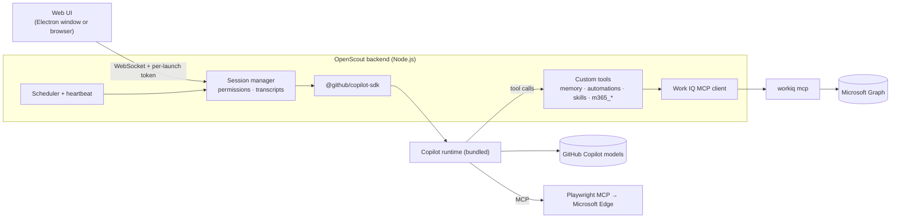

# OpenScout

A Scout-style desktop work assistant that runs on **your GitHub Copilot subscription** and reaches **your Microsoft 365 data through Work IQ**. Out of the box it never calls a Microsoft 365 Copilot API.

> **Unofficial project.** OpenScout is an independent personal project inspired by [Microsoft Scout](https://www.microsoft.com/en-us/copilot/blog/2026/06/02/introducing-microsoft-scout-your-always-on-personal-agent/). It is not affiliated with, endorsed by or supported by Microsoft or GitHub. Microsoft Scout, Microsoft 365, Work IQ and GitHub Copilot are trademarks of their respective owners. Use it at your own risk and in line with your organisation's policies.

**[▶ Try the browser demo](https://peterxing.github.io/openscout/)**: the real UI with a simulated backend and fictional Contoso data. See [Browser demo](#browser-demo).

- **Models**: GitHub Copilot, via the official [`@github/copilot-sdk`](https://www.npmjs.com/package/@github/copilot-sdk) (it bundles the Copilot agent runtime: shell, files, web search/fetch, sub-agents, skills, context compaction).
- **Microsoft 365**: the [Work IQ CLI](https://github.com/microsoft/work-iq) MCP server (`@microsoft/workiq`). OpenScout exposes only its *entity* tools, which call Microsoft Graph with your delegated sign-in, plus a Microsoft Search tool built on them.
- **Desktop shell**: Electron, with a tray icon, global shortcut and native notifications. The same UI also runs in a normal browser.

## Features

| Area | What you get |
| --- | --- |
| Chat | Streaming Markdown (tables, code highlighting, Mermaid), visible reasoning, live tool cards, image attachments (paste/drag/drop), model picker, context-usage meter, stop button |
| Microsoft 365 (Work IQ) | `m365_search` (Microsoft Search across mail, events, files, Teams messages, people, sites), `m365_fetch`, `m365_function`, `m365_fetch_file`, `m365_create`, `m365_update`, `m365_delete`, `m365_action` (send/reply/forward, accept/decline, getSchedule, findMeetingTimes…), plus schema and path discovery |
| Local and web | The Copilot runtime's built-in shell, file view/edit, glob/grep, web search and fetch. Browser automation with Playwright MCP in Microsoft Edge, using a persistent OpenScout profile |
| Permissions | Ask / auto-approve reads (default) / allow all. Approval cards show the exact command, diff or Graph payload. Writes to Microsoft 365 are always confirmed individually. Shell allow-list |
| Questions | The agent can ask you multiple-choice or free-text questions inline (`ask_user`) |
| Memory | Long-term facts and preferences, injected into new conversations. Managed from chat or the Memory page |
| Automations | Schedules in plain English ("every weekday at 9am", "every 2 hours at :15", "every hour during work hours"), condition triggers ("when an email from X arrives"), multi-step prompts, per-automation model, read-only by default, run history, desktop and email-to-self notifications |
| Heartbeat | Optional periodic check-in during work hours that only pings you when something needs attention |
| Skills | Agent Skills (`SKILL.md`) from `~/.openscout/skills`, plus your existing Microsoft Scout (`~/.scout/m-skills`) and Copilot CLI (`~/.copilot/skills`) skills. Invoke with `/skill-name` |
| History | Conversations persist and resume after restarts. Sidebar search across transcripts |
| Personalities | Balanced, Concise, Coach, Formal |

## How it works



- The Copilot runtime uses its own home, `~/.openscout/copilot`, so OpenScout's sessions, MCP servers and plugins stay separate from your Copilot CLI. On first start OpenScout copies your Copilot CLI's sign-in *pointer* (host and login only). The token itself stays in the Windows Credential Manager.
- Work IQ runs once, as a long-lived MCP process owned by the backend. Its tools are re-exposed to the model as custom tools, which lets OpenScout control naming, licence gating, permission prompts, result trimming and file downloads.

## Licensing and requirements

| Need | Details |
| --- | --- |
| GitHub Copilot | Any plan that includes Copilot CLI / SDK use (Pro, Pro+, Business, Enterprise; organisations must allow Copilot CLI). Premium-request multipliers apply per model and are shown in the model picker. |
| Microsoft 365 | Your normal M365 account. Your tenant must have granted admin consent to the **Work IQ CLI** app (client ID `ba081686-5d24-4bc6-a0d6-d034ecffed87`). See Work IQ's [admin guide](https://github.com/microsoft/work-iq/blob/main/ADMIN-INSTRUCTIONS.md). |
| Microsoft 365 Copilot licence | **Not used by default.** Work IQ's `ask`, `retrieve` and `list_agents` tools call the Microsoft 365 Copilot Chat/Retrieval APIs, so OpenScout hides them unless you turn on *Settings → Microsoft 365 → I have a Microsoft 365 Copilot licence*. |

What has been verified: with the licence toggle off, every Microsoft 365 call OpenScout made went to `https://graph.microsoft.com/v1.0` (Graph reads, writes and `POST /search/query`) with the user's delegated token.

What hasn't been verified: an account that has no Microsoft 365 Copilot licence. Work IQ is a public preview under Microsoft's [Pre-Release/Evaluation terms](https://github.com/microsoft/work-iq/tree/main/EULA), and its admin guide lists a Microsoft 365 Copilot licence as a prerequisite. A tenant can also restrict the Work IQ app to assigned users. OpenScout doesn't check for or require the licence, but whether Work IQ lets an unlicensed account sign in is decided by Work IQ and your tenant.

## Getting started

Requirements: Windows 10/11, Node.js 22.12 or newer, and Microsoft Edge (for browser automation).

```powershell
git clone https://github.com/peterxing/openscout.git
cd openscout
npm install          # fetches the Copilot runtime, Work IQ CLI, Playwright MCP and Electron
npm start            # builds and opens the desktop app
```

Browser mode (handy for debugging): `npm run web` builds, starts the backend and opens a tokenised `http://127.0.0.1:47710/?token=…` URL. `npm run serve` starts the backend without rebuilding.

The first desktop launch creates a **Start Menu → OpenScout** shortcut. Windows needs it for native notifications, and you can use it to launch the app later. The default global shortcut is **Ctrl+Alt+O**. Closing the window keeps OpenScout in the tray so automations keep running; quit from the tray menu.

### First run

1. **GitHub Copilot**: signs in automatically if you've already used `copilot login`. If not, go to *Settings → Accounts → Sign in with GitHub…* (opens a console running the device flow), then click *I've signed in*. You can also paste a fine-grained PAT that has the *Copilot Requests* permission.
2. **Microsoft 365**: if Work IQ shows *Sign-in needed*, click *Sign in…*. If it asks you to accept the Work IQ terms, review them and accept in Settings.
3. Try the suggestions on the home screen, for example "What's on my calendar today?".

## Security model

- The backend listens on **127.0.0.1 only**. Every WebSocket connection and the local-image route need a random per-launch token. `Host` and `Origin` headers are validated, which blocks DNS rebinding and cross-site WebSocket hijacking, and the UI is served with a strict Content-Security-Policy.
- The Electron renderer is sandboxed (`contextIsolation`, no Node integration, no preload). External links open in your default browser.
- Approvals:
  - Read-only actions are auto-approved by default.
  - Shell commands, file edits and Microsoft 365 changes prompt you, showing the exact command, diff or Graph payload.
  - Microsoft 365 writes can't be approved for a whole conversation.
- Automations run **read-only** unless you explicitly allow actions for that automation.
- The system prompt treats email, chat, file and web content as data, not instructions, and requires a preview plus your confirmation before anything is sent in your name.
- OpenScout stores no credentials. GitHub tokens stay in the OS keychain via the Copilot runtime; Microsoft 365 tokens stay in Work IQ's own MSAL cache.

## Data locations

| Path | Contents |
| --- | --- |
| `~/.openscout/settings.json` | Settings |
| `~/.openscout/memory.json`, `automations.json`, `automation-runs.jsonl` | Memory, automations, run history |
| `~/.openscout/sessions.json`, `transcripts/` | Conversation index and UI transcripts |
| `~/.openscout/copilot/` | Copilot runtime home (session state, logs) |
| `~/.openscout/skills/` | Your OpenScout skills |
| `~/.openscout/browser-profile/` | Playwright/Edge profile (web sign-ins persist) |
| `Documents\OpenScout` | Default working folder for files the agent creates (changeable in Settings) |

Set `OPENSCOUT_HOME` to use a different data folder.

## Browser demo

[peterxing.github.io/openscout](https://peterxing.github.io/openscout/) runs the same web UI against an in-browser simulated backend (`demo/demo-backend.js`). Use it to try the chat, tool cards, approval prompts, questions, automations, memory, skills and settings without installing anything.

- **No real data or AI**: every conversation is scripted, and all people, mail and files are fictional (Contoso). The demo makes no network calls beyond loading the page, and it resets when you reload.
- **Not the agent itself**: the real OpenScout backend controls your PC and your Microsoft 365 account, so it only ever listens on `127.0.0.1` and is never exposed publicly.
- **Deployment**: GitHub Actions rebuilds and deploys the demo on every push to `main` (`.github/workflows/pages.yml`). Build it locally with `npm run site`, which writes `site/`.

## Differences from Microsoft Scout

- **Notifications**: Scout's Teams relay bot is replaced by native desktop toasts and optional **email-to-self**. Microsoft Graph can't post to the Teams "notes to self" chat.
- **Microsoft 365 tools**: generic Graph-path tools plus `m365_search`, instead of Scout's per-feature `workiq_*` tools. Anything Work IQ permits is reachable; use `m365_search_paths` to discover paths.
- **Not included**: Scout's mini mode, workspaces, bundled skills and enterprise integrations. If you also use Scout, your own Scout skills load automatically.
- **Distribution**: runs from source; there's no installer or auto-update yet. Packaging with `electron-builder` would be the next step.

## Development

```text
src/server/       backend (Copilot SDK, Work IQ, sessions, tools, scheduler, HTTP/WS)
  tools/          custom tools exposed to the model
src/electron/     desktop shell (window, tray, shortcut, notifications)
web/              UI (vanilla ES modules; marked, DOMPurify, highlight.js, Mermaid)
demo/             simulated backend for the public browser demo
scripts/          icon generator and static-site build
test/             unit tests (node:test)
```

- `npm run build` compiles TypeScript to `dist/`, `npm test` runs the unit tests, `npm run site` builds the browser demo into `site/`, and `npm run icon` regenerates the icons.
- The UI talks to the backend through one WebSocket RPC surface. See `handle()` in `src/server/app.ts`.

## Troubleshooting

- **"GitHub Copilot · not signed in"**: run `copilot login` in a terminal, then *Settings → I've signed in*.
- **Work IQ errors such as `CircuitOpen` / "dependency is temporarily unavailable"**: these are transient service errors; ask again.
- **"Access denied for the requested path"**: Work IQ only allows certain Graph paths. Ask the agent to use `m365_search_paths`.
- **Browser automation doesn't start**: switch the browser channel (*Settings → Tools*) or install Microsoft Edge.
- **Logs**: the backend logs to the console (`npm run serve`). The Copilot runtime logs to `~/.openscout/copilot/logs`.
