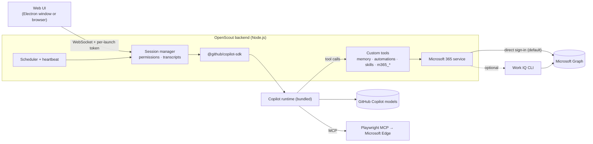

# OpenScout

A Scout-style desktop assistant for **work and study**. It runs on **your GitHub Copilot subscription** and **your Microsoft 365 work or school account**. OpenScout signs in to Microsoft 365 itself and calls Microsoft Graph, so it doesn't need a Microsoft 365 Copilot licence or Work IQ.

> **Unofficial project.** OpenScout is an independent personal project inspired by [Microsoft Scout](https://www.microsoft.com/en-us/copilot/blog/2026/06/02/introducing-microsoft-scout-your-always-on-personal-agent/). It is not affiliated with, endorsed by or supported by Microsoft or GitHub. Microsoft Scout, Microsoft 365, Work IQ and GitHub Copilot are trademarks of their respective owners. Use it at your own risk and in line with your organisation's policies.

**[▶ Try the student demo](https://peterxing.github.io/openscout/)**: the real UI with a simulated backend and fictional Contoso University data. See [Browser demo](#browser-demo).

- **Models**: GitHub Copilot, via the official [`@github/copilot-sdk`](https://www.npmjs.com/package/@github/copilot-sdk). It bundles the Copilot agent runtime: shell, files, web search and fetch, sub-agents, skills and context compaction.
- **Microsoft 365**: OpenScout signs you in with MSAL in your browser and calls Microsoft Graph directly with your delegated permissions. The [Work IQ CLI](https://github.com/microsoft/work-iq) is available as an optional alternative.
- **For students**: a Study mode with student suggestions, a Tutor personality and academic-integrity guidance. It can read class assignments from Teams for Education once your school approves that permission.
- **Desktop shell**: Electron, with a tray icon, global shortcut and native notifications. The same UI also runs in a normal browser.

## Features

| Area | What you get |
| --- | --- |
| Chat | Streaming Markdown (tables, code highlighting, Mermaid), visible reasoning, live tool cards, image attachments (paste/drag/drop), model picker, context-usage meter, stop button |
| Microsoft 365 | `m365_search` (Microsoft Search across mail, events, files, Teams messages, people and sites), `m365_fetch`, `m365_function`, `m365_fetch_file`, `m365_create`, `m365_update`, `m365_delete` and `m365_action` (send/reply/forward, accept/decline, getSchedule, findMeetingTimes and more). The Work IQ provider adds schema and path discovery |
| Study mode | Student home-screen suggestions (classes, assignments, lecture notes, emailing tutors, study plans, quizzes), a Tutor personality, and guidance that coaches rather than writes graded work. Teams for Education assignments and classes need the optional admin-approved permission |
| Local and web | The Copilot runtime's built-in shell, file view/edit, glob/grep, web search and fetch. Browser automation with Playwright MCP in Microsoft Edge, using a persistent OpenScout profile |
| Permissions | Ask / auto-approve reads (default) / allow all. Approval cards show the exact command, diff or Graph payload. Writes to Microsoft 365 are always confirmed individually. Shell allow-list |
| Questions | The agent can ask you multiple-choice or free-text questions inline (`ask_user`) |
| Memory | Long-term facts and preferences, injected into new conversations. Managed from chat or the Memory page |
| Automations | Schedules in plain English ("every weekday at 9am", "every Sunday at 6pm", "every hour during work hours"), condition triggers ("when my marks are released"), multi-step prompts, per-automation model, read-only by default, run history, desktop and email-to-self notifications |
| Heartbeat | Optional periodic check-in that only pings you when something needs attention |
| Skills | Agent Skills (`SKILL.md`) from `~/.openscout/skills`, plus your existing Microsoft Scout (`~/.scout/m-skills`) and Copilot CLI (`~/.copilot/skills`) skills. Invoke with `/skill-name` |
| History | Conversations persist and resume after restarts. Sidebar search across transcripts |
| Personalities | Balanced, Concise, Coach, Tutor, Formal |

## How it works



- **GitHub Copilot**: the Copilot runtime uses its own home, `~/.openscout/copilot`, so OpenScout's sessions, MCP servers and plugins stay separate from your Copilot CLI. On first start, OpenScout copies your Copilot CLI's sign-in *pointer* (host and login only). The token itself stays in the Windows Credential Manager.
- **Microsoft 365 (direct)**: *Settings → Microsoft 365 → Sign in* opens your browser at Microsoft's sign-in page (MSAL authorisation code flow with PKCE and a localhost redirect).
  - Tokens are cached in `~/.openscout/m365-token-cache.bin`, encrypted for your Windows account with DPAPI, and refresh silently.
  - Tools only accept relative Graph paths, so requests can't be sent anywhere except `graph.microsoft.com`.
- **Microsoft 365 (Work IQ, optional)**: the Work IQ CLI runs as one long-lived MCP process. The same `m365_*` tools are routed through it.

## Licensing and requirements

| Need | Details |
| --- | --- |
| GitHub Copilot | Any Copilot plan. They all include Copilot CLI, which provides OpenScout's agent runtime; organisations must allow Copilot CLI. Verified students get **Copilot Student** free, and verified teachers may get Copilot Pro free (see [GitHub Education](https://education.github.com/)). Copilot Free and Copilot Student use automatic model selection only, so keep the model on **Auto**, which is the default. Usage counts against your plan's GitHub AI Credits, and the model picker shows each model's multiplier. |
| Microsoft 365 | Any Microsoft 365 **work or school account**, for example Microsoft 365 A1, A3 or A5 for education, or E3/E5/Business. **No Microsoft 365 Copilot licence.** |
| Organisation approval | Reading mail, calendar, files and chats needs your organisation to allow the sign-in app. Many organisations only let administrators approve that. If you see **"Need admin approval"**, see [For schools and IT admins](#for-schools-and-it-admins). |
| Optional, admin-approved | *Teams channel messages* (`ChannelMessage.Read.All`) and *class assignments and rosters* (`EduAssignments.ReadBasic`, `EduRoster.ReadBasic`). Turn these on under Settings → Microsoft 365. |
| Work IQ (optional) | Only if you choose the Work IQ provider. Your tenant must approve the Work IQ CLI app (client ID `ba081686-5d24-4bc6-a0d6-d034ecffed87`). Work IQ's `ask`/`retrieve` tools need a Microsoft 365 Copilot licence, so OpenScout hides them unless you say you have one. |

**Verified:**
- On a work account, the direct sign-in works end to end: sign-in, Graph calls, the encrypted token cache, silent refresh after a restart, and sign-out.
- A tenant that blocks user consent shows "Need admin approval" for mail and file permissions, and OpenScout then explains what to do.
- With Work IQ, every Microsoft 365 call went to `graph.microsoft.com`.

**Not verified:** a school tenant. Whether students can approve the permissions themselves depends on the school's consent settings.

### Default sign-in app

OpenScout signs in with Microsoft's public **Microsoft Graph Command Line Tools** client (`14d82eec-204b-4c2f-b7e8-296a70dab67e`), the same app Microsoft Graph PowerShell uses. That's why the consent screen shows that name. Organisations can replace it with their own app registration (below), which is recommended for schools. Configure it under *Settings → Microsoft 365 → Sign-in app*, or set the `OPENSCOUT_M365_CLIENT_ID` and `OPENSCOUT_M365_TENANT` environment variables before first launch.

The default delegated permissions are the ones users can normally consent to themselves:

`User.Read`, `Mail.ReadWrite`, `Mail.Send`, `Calendars.ReadWrite`, `Files.ReadWrite.All`, `Sites.Read.All`, `Chat.ReadWrite`, `Team.ReadBasic.All`, `Channel.ReadBasic.All`, `People.Read`, `Tasks.ReadWrite`, `Presence.Read`

### For schools and IT admins

To let students use OpenScout with their school accounts:

1. In the [Microsoft Entra admin center](https://entra.microsoft.com), go to **App registrations → New registration**. Name it *OpenScout*, choose *Accounts in this organizational directory only*, and add the redirect URI *Public client/native (mobile & desktop)* `http://localhost`.
2. Under **API permissions → Add a permission → Microsoft Graph → Delegated**, add the permissions listed above. Optionally add `ChannelMessage.Read.All`, `EduAssignments.ReadBasic` and `EduRoster.ReadBasic`. Then select **Grant admin consent**.
3. Give students the **Application (client) ID** and your tenant (ID or domain). They enter them under *Settings → Microsoft 365 → Sign-in app*. Alternatively, deploy them with the `OPENSCOUT_M365_CLIENT_ID` / `OPENSCOUT_M365_TENANT` environment variables.

If you'd rather not register an app, you can instead grant admin consent for *Microsoft Graph Command Line Tools* with the same delegated permissions. A dedicated app is easier to scope, assign and audit.

## Getting started

Requirements: Windows 10/11, Node.js 22.12 or newer, and Microsoft Edge (for browser automation).

```powershell
git clone https://github.com/peterxing/openscout.git
cd openscout
npm install          # fetches the Copilot runtime, Playwright MCP, Electron and the optional Work IQ CLI
npm start            # builds and opens the desktop app
```

Browser mode (handy for debugging): `npm run web` builds, starts the backend and opens a tokenised `http://127.0.0.1:47710/?token=…` URL. `npm run serve` starts the backend without rebuilding.

The first desktop launch creates a **Start Menu → OpenScout** shortcut. Windows needs it for native notifications, and you can use it to launch the app later. The default global shortcut is **Ctrl+Alt+O**. Closing the window keeps OpenScout in the tray so automations keep running; quit from the tray menu.

### First run

1. **GitHub Copilot**: signs in automatically if you've already used `copilot login`. If not, go to *Settings → Accounts → Sign in with GitHub…* (opens a console running the device flow), then click *I've signed in*. You can also paste a fine-grained PAT that has the *Copilot Requests* permission.
2. **Microsoft 365**: go to *Settings → Microsoft 365 → Sign in…*, then sign in with your work or school account in the browser window that opens. If it says an administrator must approve the app, see [For schools and IT admins](#for-schools-and-it-admins).
3. **Students**: under *Settings → Model & personality*, choose **Study** and the **Tutor** personality.
4. Try the suggestions on the home screen.

Installs from before the direct connection keep using Work IQ. Switch under *Settings → Microsoft 365*.

## Security model

- The backend listens on **127.0.0.1 only**. Every WebSocket connection and the local-image route need a random per-launch token. `Host` and `Origin` headers are validated, which blocks DNS rebinding and cross-site WebSocket hijacking, and the UI is served with a strict Content-Security-Policy.
- The Electron renderer is sandboxed (`contextIsolation`, no Node integration, no preload). External links open in your default browser.
- Approvals:
  - Read-only actions are auto-approved by default.
  - Shell commands, file edits and Microsoft 365 changes prompt you, showing the exact command, diff or Graph payload.
  - Microsoft 365 writes can't be approved for a whole conversation.
- Automations run **read-only** unless you explicitly allow actions for that automation.
- The system prompt treats email, chat, file and web content as data, not instructions, and requires a preview plus your confirmation before anything is sent in your name.
- Credentials:
  - GitHub tokens stay in the OS keychain via the Copilot runtime.
  - Microsoft 365 tokens from direct sign-in are encrypted with DPAPI for your Windows account.
  - Graph requests only go to `graph.microsoft.com`, and the model can only set the `If-Match`, `Prefer` and `ConsistencyLevel` headers.

## Data locations

| Path | Contents |
| --- | --- |
| `~/.openscout/settings.json` | Settings |
| `~/.openscout/m365-token-cache.bin` | Microsoft 365 sign-in (DPAPI-encrypted) |
| `~/.openscout/memory.json`, `automations.json`, `automation-runs.jsonl` | Memory, automations, run history |
| `~/.openscout/sessions.json`, `transcripts/` | Conversation index and UI transcripts |
| `~/.openscout/copilot/` | Copilot runtime home (session state, logs) |
| `~/.openscout/skills/` | Your OpenScout skills |
| `~/.openscout/browser-profile/` | Playwright/Edge profile (web sign-ins persist) |
| `Documents\OpenScout` | Default working folder for files the agent creates (changeable in Settings) |

Set `OPENSCOUT_HOME` to use a different data folder.

## Browser demo

[peterxing.github.io/openscout](https://peterxing.github.io/openscout/) is a **student demo**. It runs the same web UI against an in-browser simulated backend (`demo/demo-backend.js`) for a fictional Contoso University student. Try checking today's classes and assignments, turning lecture slides into notes, emailing a tutor (with an approval prompt), a weekly study plan automation, a quiz, memory, skills and settings, all without installing anything.

- **No real data or AI**: every conversation is scripted, and all people, classes, mail and files are fictional. The demo makes no network calls beyond loading the page, and it resets when you reload.
- **Not the agent itself**: the real OpenScout backend controls your PC and your Microsoft 365 account, so it only ever listens on `127.0.0.1` and is never exposed publicly.
- **Deployment**: GitHub Actions rebuilds and deploys the demo on every push to `main` (`.github/workflows/pages.yml`). Build it locally with `npm run site`, which writes `site/`.

## Differences from Microsoft Scout

- **Microsoft 365 access**: OpenScout's own Graph sign-in (or Work IQ) instead of Scout's built-in connection. No Microsoft 365 Copilot licence is needed.
- **Notifications**: Scout's Teams relay bot is replaced by native desktop toasts and optional **email-to-self**. Microsoft Graph can't post to the Teams "notes to self" chat.
- **Microsoft 365 tools**: generic Graph-path tools plus `m365_search`, instead of Scout's per-feature `workiq_*` tools.
- **Not included**: Scout's mini mode, workspaces, bundled skills and enterprise integrations. If you also use Scout, your own Scout skills load automatically.
- **Distribution**: runs from source; there's no installer or auto-update yet. Packaging with `electron-builder` would be the next step.

## Development

```text
src/server/       backend (Copilot SDK, sessions, tools, scheduler, HTTP/WS)
  graph.ts        direct Microsoft Graph sign-in and client (MSAL, encrypted cache)
  m365.ts         provider-neutral Microsoft 365 service (direct Graph or Work IQ)
  tools/          custom tools exposed to the model
src/electron/     desktop shell (window, tray, shortcut, notifications)
web/              UI (vanilla ES modules; marked, DOMPurify, highlight.js, Mermaid)
demo/             simulated backend for the public student demo
scripts/          icon generator and static-site build
test/             unit tests (node:test)
```

- `npm run build` compiles TypeScript to `dist/`, `npm test` runs the unit tests, `npm run site` builds the browser demo into `site/`, and `npm run icon` regenerates the icons.
- The UI talks to the backend through one WebSocket RPC surface. See `handle()` in `src/server/app.ts`.
- `OPENSCOUT_AUTH_NO_BROWSER=1` prints the Microsoft sign-in URL instead of opening a browser, which is useful for headless testing.

## Troubleshooting

- **"GitHub Copilot · not signed in"**: run `copilot login` in a terminal, then *Settings → I've signed in*.
- **"Need admin approval" when signing in to Microsoft 365**: your organisation must approve the app. See [For schools and IT admins](#for-schools-and-it-admins).
- **HTTP 403 from Microsoft Graph**: your sign-in lacks that permission. Teams channel messages and class assignments are optional groups that an administrator must approve.
- **Asked to sign in to Microsoft 365 after every restart**: the encrypted token cache couldn't load, so tokens are only kept in memory (the backend log says why). Run `npm install` again to restore its native modules.
- **Work IQ provider errors such as `CircuitOpen` / "dependency is temporarily unavailable"**: these are transient service errors; ask again.
- **"Access denied for the requested path" (Work IQ provider)**: Work IQ only allows certain Graph paths. Ask the agent to use `m365_search_paths`, or switch to direct sign-in.
- **Browser automation doesn't start**: switch the browser channel (*Settings → Tools*) or install Microsoft Edge.
- **Logs**: the backend logs to the console (`npm run serve`). The Copilot runtime logs to `~/.openscout/copilot/logs`.
